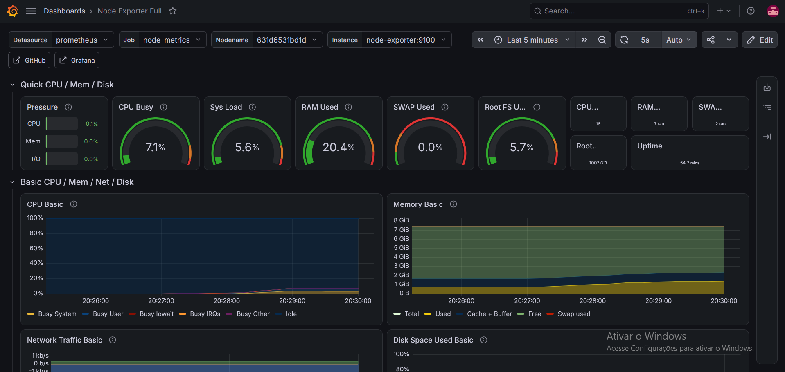

# 📊 Homelab: Stack de Monitorização e Observabilidade

Ambiente conteinerizado para recolha de telemetria, armazenamento em séries temporais e visualização de métricas de infraestrutura de hardware (CPU, memória RAM, tráfego de rede e E/S de disco) utilizando Docker e Docker Compose.

---

## 🏗️ Arquitetura da Solução
[ Servidor / Host Linux ]
│
▼
[ Node Exporter (:9100) ]  ───(Scrape a cada 15s)───>  [ Prometheus (:9090) ]  ───>  [ Grafana (:3000) ]
(Telemetria do Kernel/Hardware)                        (Base de Dados TSDB)          (Dashboards Interativos)
- **Node Exporter (`v:latest`):** Agente de recolha a nível de sistema operacional, montando os diretórios `/proc` e `/sys` do host em modo apenas de leitura.
- **Prometheus (`v:latest`):** Motor de *scraping*, processamento de consultas e armazenamento em formato Time Series Database.
- **Grafana (`v:latest`):** Camada de observabilidade e renderização de dados analíticos via dashboards em tempo real (Painel base: Node Exporter Full - ID `1860`).

---

## 🖥️ Demonstração do Painel

> Insere aqui a captura de ecrã do teu Grafana em execução.
> Guarda a imagem com o nome `dashboard.png` na raiz do repositório.

---

## 🚀 Como Executar o Ambiente

### Pré-requisitos
- [Docker Engine](https://docs.docker.com/engine/install/) (v20.10+)
- [Docker Compose](https://docs.docker.com/compose/) (v2.0+)

### 1. Clonar o repositório
git clone [https://github.com/chilldio1/homelab-monitoring.git](https://github.com/chilldio1/homelab-monitoring.git)
cd homelab-monitoring
### 2. Iniciar os Serviços
docker compose up -d
### 3. Verificar os estados dos conteineres 
docker compose ps
### 4. Aceder aos Serviços

| Serviço | Endpoint Local | Credenciais Padrão |
| :--- | :--- | :--- |
| **Grafana** | `http://localhost:3000` | Utilizador: `admin` \| Senha: `admin` |
| **Prometheus** | `http://localhost:9090` | Acesso direto |
| **Node Exporter** | `http://localhost:9100/metrics` | Acesso direto |

---

### 📈 Configuração do Dashboard no Grafana

1. Aceder a `http://localhost:3000` e iniciar sessão.
2. Navegar até **Connections > Data Sources > Add data source** e selecionar **Prometheus**.
3. No campo **Prometheus server URL**, definir `http://prometheus:9090` (resolução interna de rede Docker) e clicar em **Save & Test**.
4. Ir ao menu lateral em **Dashboards > New > Import**, inserir o ID `1860` e clicar em **Load**.
5. Selecionar a fonte criada (**Prometheus**) e confirmar a importação.

---

### 🔐 Boas Práticas e Segurança para Ambientes Corporativos

Neste laboratório local, a comunicação ocorre numa rede em modo *bridge* restrita ao host. Em infraestruturas corporativas de produção, aplicam-se as seguintes configurações:

- **Encriptação em Trânsito (TLS/HTTPS):** Implementação obrigatória de certificados digitais nos endpoints do Node Exporter e da API do Prometheus através de parâmetros `web.config.file`.
- **Controlo de Acesso e Autenticação:** Proteção das rotas de consulta com *Basic Auth* (hashes bcrypt) ou *Bearer Tokens* assinados.
- **Isolamento de Rede:** Bloqueio das portas `9090` e `9100` a acessos externos, expondo apenas a interface web através de um Proxy Reverso (Nginx, Traefik ou Caddy) com regras de *rate limiting* e firewall (UFW/iptables).
